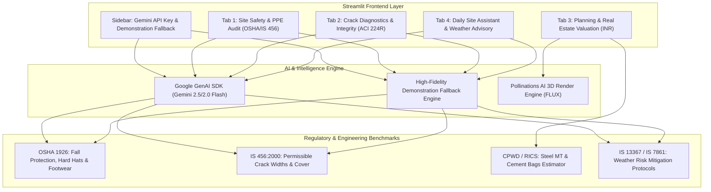

# 🏗️ Multimodal Construction Intelligence Platform
### Skill Wallet Capstone Project 1 • Production-Ready Streamlit Application

[](https://streamlit.io)
[](https://www.python.org/downloads/)
[](https://ai.google.dev/)
[](https://www.bis.gov.in)

---

## 📌 Executive Summary

The **Multimodal Construction Intelligence Platform** is an enterprise-grade AI copilot designed for site engineers, QA/QC managers, structural auditors, and real estate developers. It combines **Google Gemini Multimodal Vision**, Indian and international civil engineering standards (**IS 456:2000, OSHA 1926, NBC 2016**), real estate parametric valuation models, and the **Pollinations AI FLUX** rendering engine to automate site inspection, safety enforcement, defect diagnostics, and financial feasibility analysis.

---

## 🏛️ System Architecture



---

## 🚀 Core Modules & Features

### 1. 🔑 Sidebar & Security
- **Secure Gemini API Key Input**: Masked password field (`type="password"`) stored strictly in ephemeral browser memory. Supports `os.environ["GEMINI_API_KEY"]` and `st.secrets["GEMINI_API_KEY"]`.
- **Graceful Demonstration Fallback**: Runs out-of-the-box in Demonstration Mode if no key is entered. Evaluators and reviewers can test all modules with zero configuration.
- **Architecture & System Specifications**: Clear breakdown of AI models, civil codes, and data pipelines.

### 2. 🦺 Tab 1: Site Safety & PPE Compliance Audit (Epic 2)
- **Multimodal Visual Inspection**: Analyzes site photos (JPG/PNG) for worker PPE adherence under **OSHA 1926** and **IS 456 / IS 2925 / IS 3521**.
- **Audited PPE Items**:
  - Industrial Safety Helmets (IS 2925 / OSHA 1926.100)
  - High-Visibility Retro-reflective Vests (IS 15809 / OSHA 1926.201)
  - Steel-Toe Safety Boots (IS 15298 / OSHA 1926.96)
  - Full-Body Safety Harnesses & Lifelines (IS 3521 / OSHA 1926.502)
- **Structured JSON Output**:
  - `safety_score` (0–100 integer)
  - `overall_status` (Compliant, Moderate Risk, High Risk, Critical Violation)
  - `ppe_detection` item checklist with detected and compliant worker counts
  - `identified_hazards` with severity levels (Low, Medium, High, Critical) and actionable corrective remedies
- **Visual Analytics**: Interactive Plotly Safety Index donut gauge, severity distribution bar charts, metric cards, and downloadable JSON report.

### 3. 🧱 Tab 2: Concrete Crack Diagnostics & Structural Integrity (Epic 2)
- **Defect Classification**:
  - **Hairline**: Early plastic shrinkage / thermal crazing (< 0.2 mm)
  - **Settlement**: Differential foundation subsidence
  - **Structural Shear**: 45° diagonal tension failure across beam-column connections
  - **Thermal Expansion**: Cyclic expansion-contraction strain
  - **Spalling**: Concrete cover bursting due to electrochemical rebar oxidation
- **Quantitative Forensics**: Estimated crack width in millimeters vs. **IS 456:2000 Clause 35.3.2** permissible threshold limits (0.3 mm mild, 0.2 mm moderate, 0.1 mm severe).
- **Engineering Remediation Protocols**:
  - Low-viscosity epoxy pressure injection (ASTM C881 / IS 456 Annex E)
  - Carbon Fiber Reinforced Polymer (CFRP) composite shear wrapping (ACI 440.2R)
  - Polymer Modified Mortar (PMM) and sacrificial zinc rebar passivation
- **Report Export**: Downloadable structured forensic JSON inspection report.

### 4. 📊 Tab 3: Planning, CapEx & Real Estate Valuation (Epic 3)
- **Parametric Inputs**:
  - Structure Typologies: Residential High-Rise (RCC Shear Wall), Commercial Office Complex (PT Slabs), Industrial PEB Warehouse, Luxury Villa Community, Institutional Campus.
  - Built-Up Area: 1,000 to 1,000,000 Sq. Ft.
  - Indian Geographic Tiers: Tier 1 Metros (Mumbai MMR, Bengaluru, Delhi-NCR, Hyderabad), Tier 2 Growth Hubs (Pune, Ahmedabad, Chennai, Kolkata), Tier 3 Emerging Smart Cities.
  - Completion Progress Slider (0% to 100%).
- **Financial & Quantity Calculations**:
  - Total Civil & MEP Project Budget (adjusted by tier indices and specification grade).
  - Capital Expenditure (CapEx) Incurred to date.
  - Current WIP Asset Valuation in INR (formatted dynamically in **Lakhs / Crores**).
  - Projected Market Asset Valuation at Handover.
  - Dynamic Milestone Phase tracking (Substructure -> RCC Superstructure -> MEP -> Finishing).
  - **Material Consumption Ratios**: Metric Tonnes (MT) of Fe 500D TMT Steel Rebar and 50kg Bags of OPC 53 / PPC Cement.
- **Pollinations AI Conceptual 3D Architectural Rendering**:
  - Dynamic prompt synthesis adapting to structure typology, location tier, architectural style, facade materiality, and lighting conditions.
  - Direct integration with Pollinations AI FLUX engine for instant 1024x640 concept visualization.

### 5. 🌤️ Tab 4: Daily Site Assistant & Weather-Aware Advisory (Epic 5)
- **Weather Condition Presets**:
  - **High Wind (> 38 km/h)**: Tower crane shutdown (IS 13367 / OSHA 1926.1431), mast climber lockout, weathervaning protocols.
  - **Heavy Rain / Monsoon**: Concreting moratorium to prevent w/c ratio wash-out, trench shoring inspection, electrical distribution board de-energization.
  - **Extreme Heat (> 40°C)**: IS 7861 (Part 1) hot-weather concreting, flake ice substitution, night-pour scheduling, worker hydration pauses.
  - **Normal Conditions**: Standard IS 456 curing regimes.
- **Interactive Multi-Turn Construction Engineering Chatbot**:
  - Multi-turn conversation preserving context in `st.session_state`.
  - Quick inquiry chips for rapid testing.
  - Comprehensive domain knowledge in Indian Standards and site QA/QC.

---

## 💻 Local Installation & Quickstart

```bash
# 1. Clone or navigate to the repository
cd vibe_coding

# 2. (Optional) Create a virtual environment
python3 -m venv venv
source venv/bin/activate  # On Windows: venv\Scripts\activate

# 3. Install dependencies
pip install -r requirements.txt

# 4. Launch the Streamlit application
streamlit run app.py
```

The application will start at `http://localhost:8501`.

---

## ☁️ 1-Click Deployment to Streamlit Community Cloud

1. Push this repository to GitHub.
2. Visit [share.streamlit.io](https://share.streamlit.io).
3. Select your repository, branch (`main`), and set the main file path to `app.py`.
4. *(Optional)* Add your Gemini API Key in **Advanced Settings -> Secrets**:
   ```toml
   GEMINI_API_KEY = "AIzaSyYourGeminiApiKeyHere"
   ```
5. Click **Deploy**. The platform will deploy in under 60 seconds with zero external database dependencies!

---

## 📁 Repository Structure

```
vibe_coding/
├── app.py                     # Main Streamlit application entrypoint & routing
├── requirements.txt           # Production dependencies for Streamlit Cloud
├── README.md                  # Complete technical documentation
├── .streamlit/
│   └── config.toml            # Custom theme & server optimization
├── modules/
│   ├── __init__.py
│   ├── config.py              # Constants, city tiers, structures, weather rules
│   ├── gemini_client.py       # Google GenAI wrapper with fallback & JSON parsing
│   ├── tab_safety.py          # Tab 1: PPE compliance audit (OSHA/IS 456)
│   ├── tab_cracks.py          # Tab 2: Defect classification & crack diagnostics
│   ├── tab_valuation.py       # Tab 3: Planning, INR valuation & Pollinations AI
│   ├── tab_assistant.py       # Tab 4: Weather advisory & multi-turn chatbot
│   ├── mock_data.py           # Synthetic realistic benchmark data for demo mode
│   └── ui_components.py       # Custom CSS, metric cards, status pills, charts
└── sample_images/             # Pre-packaged inspection frames for 1-click testing
    ├── sample_safety_1.jpg    # Scaffolding inspection frame
    ├── sample_safety_2.jpg    # Trench & rebar inspection frame
    ├── sample_crack_1.jpg     # Column shear crack specimen
    ├── sample_crack_2.jpg     # Plaster hairline crazing specimen
    └── sample_crack_3.jpg     # Beam concrete spalling specimen
```

---

## 📜 Compliance & Regulatory References
- **IS 456:2000**: Plain and Reinforced Concrete - Code of Practice
- **IS 2925:1984**: Specification for Industrial Safety Helmets
- **IS 3521:1999**: Industrial Safety Belts and Harnesses
- **IS 15298**: Personal Protective Equipment - Protective Footwear
- **IS 13367**: Code of Practice for Safe Use of Cranes
- **IS 7861 (Part 1)**: Recommended Practice for Hot Weather Concreting
- **OSHA 1926**: Safety and Health Regulations for Construction (Subparts E, M, CC)
- **ACI 224R-01**: Control of Cracking in Concrete Structures
